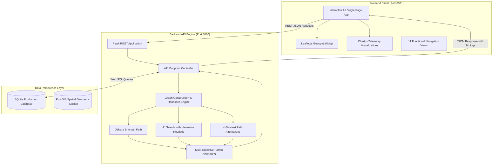

# City Bus Route Optimization Analyzer

> An intelligent, smart-city urban bus transit optimization and analytics platform featuring Dijkstra, A* search with Haversine heuristics, multi-criteria Pareto scoring, real-time congestion mitigation, and interactive geospatial mapping.

[](https://github.com/Nishanth6153/City-Bus-Route-Optimization-Analyzer-using-Hive)
[](https://www.python.org/)
[](https://postgis.net/)
[](http://localhost:8080/api/health)

---

## 1. Project Overview & Problem Statement

Urban transit networks in rapidly growing smart cities face severe operational challenges:
- **Severe Road Congestion**: Bottlenecks increase commuter travel times by 30–60%.
- **Suboptimal Route Planning**: Conventional routing engines fail to balance multi-criteria trade-offs (fare vs. speed vs. physical distance vs. passenger boarding capacity).
- **Static Fleet Dispatch**: Operators lack real-time visibility into corridor bottlenecks, resulting in bus bunching and irregular headways.

### The Solution
The **City Bus Route Optimization Analyzer** resolves these bottlenecks by combining graph theory (Dijkstra, A*, and Yen's K-Shortest Paths) with dynamic traffic telemetry. Transit authorities and passengers can evaluate Pareto-optimal paths, minimize transfers, avoid congested corridors, and inspect comprehensive telemetry dashboards in real time.

---

## 2. Key Features

- **⚡ Multi-Objective Route Optimization**:
  - `Balanced Mode`: Standardized utility scoring combining travel time, distance, fare, and congestion penalties.
  - `Fastest Mode`: Minimizes total travel duration adjusted for live traffic delays.
  - `Shortest Mode`: Minimizes geographic road distance.
  - `Low Congestion Mode`: Exponentially penalizes high-congestion corridors to route around bottlenecks.
  - `High Demand Mode`: Prioritizes routes servicing high passenger densities.
  - `Low Cost Mode`: Computes the most economical commuter fare tariff.
- **🗺️ Interactive Geospatial Mapping**: Powered by Leaflet.js, visualizing stops, directional route lines, origin/destination markers, and corridor layers.
- **📊 Real-Time Analytics & Telemetry**:
  - 24-hour commuter demand distribution curves.
  - Fleet allocation and occupancy load monitoring.
  - Speed vs. Congestion scatter analytics.
- **📜 Complete Audit Trail**: Records every optimization query with measured latency in milliseconds and scoring history.
- **🚏 Transit Inventory Management**: Full CRUD capabilities for bus stops and bus routes.

---

## 3. System Architecture



---

## 4. Technology Stack

- **Backend Framework**: Python 3, Flask, Flask-CORS
- **Algorithms & Mathematics**: NetworkX, SciPy, NumPy, Heapq
- **Database Layer**: SQLite (zero-dependency default, WAL mode) & PostgreSQL / PostGIS (spatial deployment)
- **Frontend Architecture**: Vanilla HTML5, CSS3, JavaScript (ES6+)
- **Mapping & Charts**: Leaflet.js 1.9.4, Chart.js 4.4.0
- **Containerization**: Docker, Docker Compose

---

## 5. Database Schema & PostGIS

The system operates on 9 core relational tables:
1. `bus_stops`: Stop codes, names, geographic coordinates (`latitude`, `longitude`), zone, and passenger load.
2. `bus_routes` (view `routes`): Route designation, line names, frequency, and capacity.
3. `route_stops`: Sequential stop ordering for each route line.
4. `route_edges`: Directed links with physical distance (km), travel time (min), tariff fare (₹), and congestion multiplier.
5. `buses`: Active fleet registry with driver names, status (`ON_ROUTE`, `IDLE`, `MAINTENANCE`), and live occupancy loads.
6. `demand_data`: 24-hour hourly commuter volume, boardings, and alightings.
7. `congestion_data`: Telemetry tracking hourly corridor speeds and traffic factors.
8. `optimization_runs`: Audit history storing origin, destination, mode, algorithm, execution time, and score.
9. `optimization_results`: Candidate route metrics, transfers, and stop sequences.

*PostGIS Support*: The project includes `database/schema_postgres.sql` featuring `GEOMETRY(Point, 4326)` columns, automated triggers, and spatial `GIST` indexes.

---

## 6. Optimization Algorithms & Mathematical Formulation

### 1. Edge Weight Functions $w(e)$
- **Fastest**: $w(e) = \text{travel\_time} \times \text{congestion}$
- **Shortest**: $w(e) = \text{distance\_km}$
- **Low Congestion**: $w(e) = \text{travel\_time} \times (\text{congestion})^{2.5}$
- **High Demand**: $w(e) = (\text{travel\_time} \times \text{congestion}) / (\text{demand\_factor})^{1.2}$
- **Low Cost**: $w(e) = \text{fare}$
- **Balanced**:
  $$w(e) = 0.40 \cdot \frac{t_e c_e}{10} + 0.25 \cdot \frac{d_e}{5} + 0.15 \cdot \frac{f_e}{15} + 0.20 \cdot (c_e - 1) \cdot 2$$

### 2. A* Admissible Heuristic
Calculates great-circle distance between current node $(lat_1, lon_1)$ and destination $(lat_2, lon_2)$:
$$d = 2 R \arcsin\left(\sqrt{\sin^2\left(\frac{\Delta \text{lat}}{2}\right) + \cos(\text{lat}_1)\cos(\text{lat}_2)\sin^2\left(\frac{\Delta \text{lon}}{2}\right)}\right)$$
Lower-bound travel time heuristic: $h(u) = (d / 45.0) \times 60$ minutes.

### 3. Optimization Score (0–100)
$$\text{Score} = 100 - \left( 0.8 \cdot T + 2.0 \cdot D + 0.8 \cdot F + 7.0 \cdot \text{Transfers} + 20.0 \cdot (C - 1) \right) + \text{Bonus}_{\text{demand}}$$

---

## 7. Installation & Quick Start

### Prerequisites
- Python 3.10+ (Tested on Python 3.11 & 3.14)
- Git

### 1. Clone Repository
```bash
git clone https://github.com/Nishanth6153/City-Bus-Route-Optimization-Analyzer-using-Hive.git
cd "City-Bus-Route-Optimization-Analyzer-using-Hive"
```

### 2. Setup Backend Dependencies
```bash
cd backend
pip install -r requirements.txt
```

### 3. Initialize & Seed Database
```bash
python seed.py
```
*Output: Seeds 22 bus stops, 6 routes, 61 edges, 16 buses, and 528 demand telemetry records.*

---

## 8. Startup & Shutdown Commands

### Start Backend API Server (Port 8080)
```bash
cd backend
python app.py
```

### Start Frontend Client (Port 8081)
In a separate terminal:
```bash
cd frontend
python -m http.server 8081
```

### Accessing the Web Application
Open your web browser and navigate to:
```
http://localhost:8081/
```

### Shutdown Commands
To cleanly shut down the servers:
- Press `Ctrl + C` in both the backend and frontend terminal windows.
- On Windows PowerShell, to terminate running background instances:
  ```powershell
  Stop-Process -Name python -Force
  ```

---

## 9. Automated Testing & Verification

A comprehensive 79-point automated test suite verifies all system components:
```bash
cd backend
python verify.py
```
### Test Coverage
- `STEP 1`: Environment Health & Telemetry Probes
- `STEP 2`: Network Topology Graph API
- `STEP 3`: Bus Stops CRUD (Create, Read, Update, Delete)
- `STEP 4`: Route & Edge Continuity
- `STEP 5`: Fleet Registry & Telemetry Data
- `STEP 6`: Graph Algorithms (Dijkstra, A*, Yen's K-Shortest)
- `STEP 7`: All 6 Optimization Modes
- `STEP 8`: Optimization History Logging
- `STEP 9`: Edge Cases & Error Handling (HTTP 400 & 404 validation)

**Result:** `79 PASSED, 0 FAILED`

---

## 10. Demo Workflow: Step-by-Step

1. Open `http://localhost:8081/` in your browser.
2. Select **Origin Stop**: `Central Bus Stand` (S01).
3. Select **Destination Stop**: `Railway Station` (S02).
4. Choose Objective Mode: **Balanced**.
5. Click **🚀 Optimize Route**.
6. Observe:
   - Route path polyline highlighted on the interactive Leaflet map.
   - Real-time execution latency measured in milliseconds (`~0.15 ms`).
   - Standardized optimization score (e.g. `99.4/100`).
   - Computed Distance, Travel Time, Fare, Transfers, Congestion, and Serviced Passenger Demand.
   - Alternative routes ranked under Yen's K-Shortest Paths.
7. Switch Objective Mode to **Fastest** or **Low Congestion** and observe instant dynamic recalculation.

---

## 11. Troubleshooting

| Issue | Cause | Solution |
|---|---|---|
| `Port 8080 already in use` | Another process is occupying port 8080 | Run `netstat -ano \| findstr :8080` and terminate the PID, or configure `PORT` in `.env`. |
| `API DISCONNECTED badge` | Backend server is not running | Ensure `python app.py` is started in the `backend/` directory. |
| `Leaflet map appears grey` | Container resized before map init | Switch views or call `map.invalidateSize()`; automated in `index.html`. |
| `Foreign key constraint error` | Database schema mismatch | Run `python seed.py` to reset and seed a fresh clean database. |

---

## 12. License
Distributed under the MIT License. Developed for smart city transit optimization.
