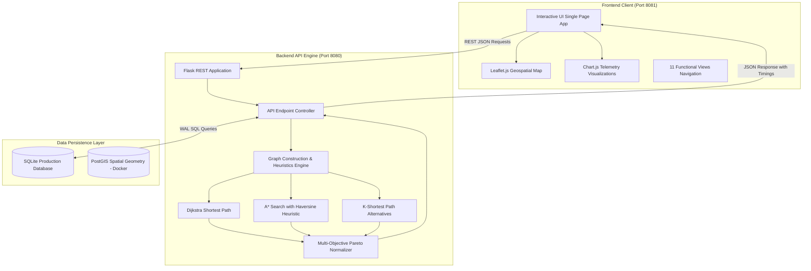

# System Architecture

The **City Bus Route Optimization Analyzer** is engineered as a decoupled, multi-tier intelligent transit analytics and routing platform.

## Component Architecture

### 1. Presentation Tier (`frontend/index.html`)
- Built with standard HTML5, CSS3, and modern ECMAScript.
- **Leaflet.js**: Renders city transit maps, interactive marker stops, route polylines, and popups.
- **Chart.js**: Renders passenger flow curves, fleet distribution doughnut charts, corridor congestion timelines, and candidate score comparison bar charts.
- **Responsive Navigation**: 11 dedicated functional views: Dashboard, Route Optimizer, Bus Network, Bus Stops, Routes, Demand Analytics, Congestion, Fleet, Optimization History, Reports, and Settings.

### 2. Computation Tier (`backend/app.py`, `backend/graph.py`)
- **Flask REST API**: Serves JSON endpoints with full CORS enablement.
- **Graph Builder**: Ingests transit network vertices (stops) and edges (corridors) into directed adjacency lists.
- **Routing Algorithms**:
  - `Dijkstra`: Exhaustive shortest path algorithm.
  - `A*`: Goal-directed heuristic search using Great-Circle Haversine distance.
  - `Alternative Paths`: Edge-exclusion penalty routing producing up to 3 candidate alternatives.
- **Real-Time Execution Timing**: Measures latency using `time.perf_counter()` to sub-millisecond precision.

### 3. Data Tier (`backend/database.py`, `database/`)
- **SQLite Engine**: Zero-configuration, zero-dependency embedded database operating with Write-Ahead Logging (`WAL`) for concurrent reads.
- **PostgreSQL / PostGIS**: Supported for enterprise containerized deployments via `docker-compose.yml`.
